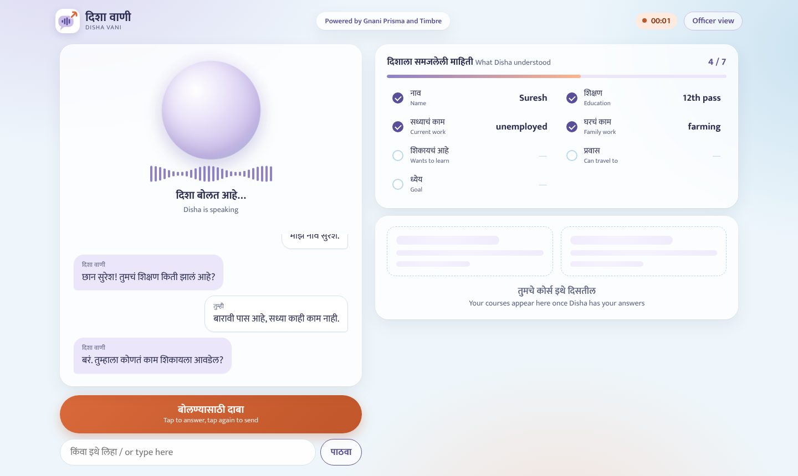

# Disha Vani (दिशा वाणी)

**A Marathi voice helpline that guides people to skill-training courses they can actually join.**
Built solo by Varad Bidwai for Gnani AI's Great Indian AI Internship Challenge 2026.



Skill-training schemes are usually reached through portals that expect people to read, type and compare eligibility rules on their own. Many of the people these schemes are meant for would rather just talk, often in Marathi or a Marathi-Hindi-English mix. Disha Vani turns that into a short spoken conversation.

## What it does

1. The caller taps **Call** and Disha greets them in Marathi.
2. Disha asks a few short spoken questions: name, schooling, current work, family work, what they want to learn, how far they can travel, and whether they want a job or their own business. Answers can be in Marathi, Hindi, English or a mix.
3. A live tracker shows what Disha has understood. If an answer is too vague (for example "high demand courses"), Disha asks one follow-up with concrete examples.
4. Disha suggests courses from **11 qualifications verified on the National Qualifications Register (NQR)**, checks each course's official entry routes, and reads the top option aloud, including hard requirements such as a driving licence.
5. If the caller asked for a course they don't qualify for yet, Disha says what they would need (for example "8th pass and ITI") instead of hiding it.
6. The caller can share a result card on WhatsApp. An officer view shows every call, the reasons behind each suggestion, a fairness check and a simulated 30-day follow-up call.

## Gnani AI models used

| Model | Role |
| --- | --- |
| **Prisma v3.0** (speech to text) | Transcribes each spoken answer, with Marathi, Hindi and English language hints for code-mixed speech |
| **Timbre v3.0** (text to speech) | Speaks every reply in Marathi or Hindi (Shivani voice) |

Both are called through Gnani's REST API ([docs.gnani.ai](https://docs.gnani.ai)). Gemini is used only to extract profile facts from each answer and phrase the next question, because Evon v3.3 is not yet available on Gnani's API. The call flow, eligibility rules and fairness guardrail are plain Python.

## How one turn works

```
Browser mic → 16 kHz WAV → Gnani Prisma (speech to text)
           → Gemini (extract facts, write next question)
           → Python (decide next topic, eligibility, guardrail)
           → Gnani Timbre (speak the reply) → Browser
```

Measured per turn on a laptop: about 1 s speech to text, 2 to 3 s Gemini, 2 s voice. A short "हं, बरं" filler plays while Disha thinks.

## Design decisions

- **Code controls the call, not the LLM.** Python decides which question comes next, when the call ends and what is fair. If Gemini is slow or unavailable, each request times out and a fixed Marathi question bank keeps the call going.
- **Fairness guardrail.** Courses are ranked without looking at family occupation. Only afterwards can family occupation add one optional course; the code checks that nothing was removed and the order is unchanged, and logs that proof for every call.
- **Verified data, not guesses.** Each course in `courses.json` carries its official code, NSQF level, notional hours, entry routes and source link, checked on 7 Nov 2026.
- **Honest about limits.** Disha cannot verify work experience or licences, so the officer confirms those.

## Run it locally

Requires Python 3.10 or newer, a Gnani API key ([app.gnani.ai/voice](https://app.gnani.ai/voice)) and a Gemini API key ([aistudio.google.com](https://aistudio.google.com)).

```bash
python -m venv .venv
# Windows: .venv\Scripts\Activate.ps1    macOS/Linux: source .venv/bin/activate
pip install -r requirements.txt
cp .env.example .env        # then paste your two keys into .env
uvicorn app:app --reload
```

Open http://localhost:8000 for the call screen and http://localhost:8000/officer for the officer view.

Optional settings in `.env`: `GEMINI_MODEL`, `GEMINI_REQUEST_TIMEOUT`, `STT_MODEL`, `TTS_VOICE`, `DAILY_CALL_LIMIT`, `PER_VISITOR_LIMIT`, `AUTO_SAMPLES`.

## Project structure

| File | Purpose |
| --- | --- |
| `app.py` | FastAPI server: call API, officer API, demo limits |
| `brain.py` | Interview engine (one Gemini call per turn, with fallback) |
| `recommender.py` | Eligibility check, scoring and fairness guardrail |
| `courses.json` | 11 NQR-verified qualifications with sources |
| `gnani.py` | Gnani Prisma and Timbre client |
| `config.py` | All settings, read from `.env` |
| `static/` | Call screen, officer view, styles and logo |
| `cli_chat.py`, `test_voice.py`, `test_gemini.py`, `day1_check.py` | Terminal tests used during development |

## Data and privacy

The demo uses **synthetic callers only**: no real phone numbers, Aadhaar, PAN, account numbers or recorded calls. Course information is public NQR data. On the public demo, calls are capped per day to protect API credits, and visitors are asked not to share personal details.

## What's next

A missed-call phone number (for example through Exotel) so it works on keypad phones, live streaming audio to cut latency, real training-centre locations by district, and a pilot with one block skill office.
